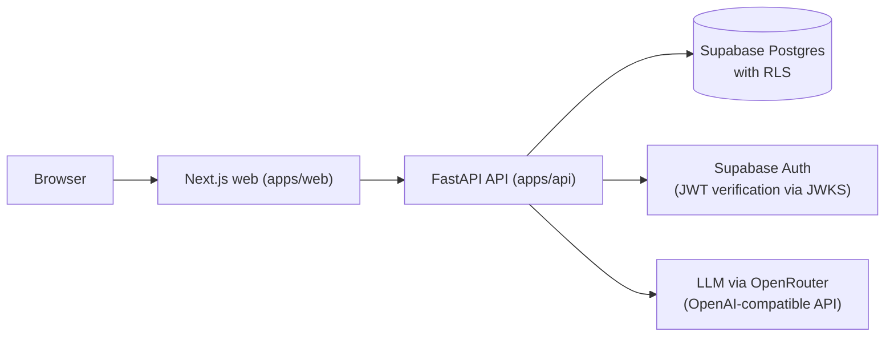

# TokoLangkah


A commerce application for a fictional Indonesian footwear store: a product catalogue, a customer assistant that answers store-policy questions with sources, a customer's own order list, and a staff console for handling escalated conversations.

All products, orders, policies and accounts are synthetic.


## Overview

TokoLangkah is a reference implementation of a customer-facing store assistant. Customers can browse footwear with IDR prices and size availability, ask the assistant about store policies and products in Indonesian, check the status of their own orders, and ask for a human. Every escalation becomes a durable ticket that staff can answer from a console, and the assistant stays out of the conversation until the ticket is resolved.

It is built for developers and reviewers who want to see how an AI-assisted customer service flow can be kept grounded and authorised: answers are extracted from versioned policy text with citations that the backend validates, product searches are exact, and every database read runs under row-level security as the signed-in user. The assistant runs on a large language model through any OpenAI-compatible endpoint (developed and tested with OpenRouter), and every tool call and citation it produces passes the same backend validation layer.

## Key features

**Customer storefront**
- Catalogue with product photos, IDR prices and in-stock EU sizes (no stock counts or ratings are shown to customers).
- Product filters in the URL (size, budget, sort), a size picker on the product page, and a browser-only cart. The cart does not take payment and does not create orders.
- Store help page (`/bantuan`) that shows every active policy verbatim, with search.

**Customer assistant (sign-in required)**
- Policy answers extracted from active policy versions, with a source drawer showing title, version, section and excerpt.
- Exact product search: budget phrases such as "di bawah 500 ribu" (below 500,000, exclusive) and "maksimal 500 ribu" (up to 500,000, inclusive) become hard filters; sizes must be in stock.
- Removable filter chips, clarification for ambiguous budgets, and no silent broadening of filters.
- Listing the signed-in customer's own orders (for example, orders that have not arrived yet) without asking for an order number.
- Idempotent message retries, and recovery from rate-limit and unavailable responses that keeps the typed text.

**Orders and accounts**
- Customers see only their own orders. Another customer's order number looks the same as a missing one.
- Sign-up through Supabase Auth; the API then registers the account as a customer of the store.

**Human handoff**
- One durable ticket per escalation request; concurrent retries create one row.
- While a ticket is unresolved, the assistant does not run. Customer messages go to staff, staff replies from the console, and the chat shows the replies (polled every 5 seconds).
- Resolving the ticket returns the conversation to the assistant.
- Staff access is checked server-side through store membership. Status changes and replies are audited.

**Staff console**
- Ticket queue with filters and a waiting count, conversation view, reply box, status controls and audit history (`/staf`).
- Stock management per size (`/staf/stok`), with optimistic concurrency so a concurrent change is never overwritten, and audit records.

## Screenshots

| Customer assistant (`/asisten`) | Staff console (`/staf`) |
|---|---|
|  |  |
| Policy and product questions with active filter chips and matching products. | Ticket queue, an escalated conversation, staff reply box, status controls and audit history. |

Screenshots were taken from the Docker build with an OpenRouter model, signed in as synthetic accounts.

## Tech stack

| Layer | Technology |
|---|---|
| Web | Next.js 16, React 19, TypeScript, Tailwind CSS 4 (`apps/web`) |
| API | FastAPI, Pydantic 2, Python 3.12, uv (`apps/api`) |
| Database | Supabase PostgreSQL with row-level security; pgvector for hybrid retrieval |
| Auth | Supabase Auth; the API verifies ES256 JWTs against JWKS |
| Assistant | LLM via any OpenAI-compatible endpoint (OpenRouter); optional embeddings for hybrid retrieval |
| Runtime | Docker Compose (API and web images) |

## Architecture



- Every user query runs inside a transaction that switches to the `authenticated` role with the verified `sub` claim, so RLS applies. Requests use the non-owner role `tokolangkah_api` (migration 0007), not the table owner.
- The assistant proposes tool calls. The backend validates arguments (`extra=forbid`), sets the customer identity and store itself, and checks each citation against the evidence retrieved in the same turn.

## Running with Docker

Requirements: Docker with Compose, a Supabase project (free tier is enough), and an OpenRouter API key (or any other OpenAI-compatible endpoint).

1. Clone the repository and create `.env`:

   ```bash
   git clone https://github.com/jaymacode/toko-langkah.git
   cd toko-langkah
   cp .env.example .env
   ```

2. Fill in `.env`:

   | Variable | Where to find it |
   |---|---|
   | `SUPABASE_URL`, `SUPABASE_PUBLISHABLE_KEY` | Supabase: Project Settings > API. Copy the same two values into `NEXT_PUBLIC_SUPABASE_URL` and `NEXT_PUBLIC_SUPABASE_PUBLISHABLE_KEY`. |
   | `SUPABASE_SERVICE_ROLE_KEY` | Supabase: Project Settings > API (secret key). Used only by the setup job to create the synthetic accounts. |
   | `DATABASE_URL` | Supabase: Connect > Session pooler, as the `postgres` user. |
   | `API_DATABASE_URL` | The same pooler URL with the user `tokolangkah_api.<project-ref>` and a password you choose. The setup job assigns that password to the role. |
   | `OPENAI_API_KEY`, `OPENAI_MODEL` | Your OpenRouter key and a model id, for example `nvidia/nemotron-3.5-super-vl:free`. `OPENAI_BASE_URL` already points to OpenRouter. |
   | `LIVE_EVAL_BUDGET_USD` | Spend cap for model calls (default `1`). `0` blocks every call. |

3. Run the one-time setup (migrations, synthetic store data and accounts):

   ```bash
   docker compose --profile setup run --rm setup
   ```

   The generated passwords for the synthetic customer and staff accounts are written to `artifacts/demo-credentials.json` (gitignored). Running setup again rotates them.

4. Start the app:

   ```bash
   docker compose up -d --build
   ```

   - Web: http://localhost:3000 (assistant at `/asisten`, staff console at `/staf`)
   - API: http://localhost:8000 (`/health` reports the active model provider)

   Stop it with `docker compose down`.

Only the publishable key may use a `NEXT_PUBLIC_` prefix. `NEXT_PUBLIC_*` values are baked into the web image at build time, so rebuild (`--build`) after changing them.

## Project structure

```
apps/web/      Next.js storefront, assistant, staff console (Dockerfile)
apps/api/      FastAPI API, assistant, retrieval, admin jobs (Dockerfile)
db/migrations/ SQL migrations 0001–0013, including RLS policies
data/          Synthetic store data and policies
assets/        README screenshots
```

## Status

Runs locally with Docker Compose against a Supabase project and an OpenRouter model. Not deployed.

## Built with AI assistance

Implemented with the help of AI coding agents, from written product and architecture specs.

## Author

Jaya Saputra, Full-stack Developer
LinkedIn: https://linkedin.com/in/jayasssaputra
